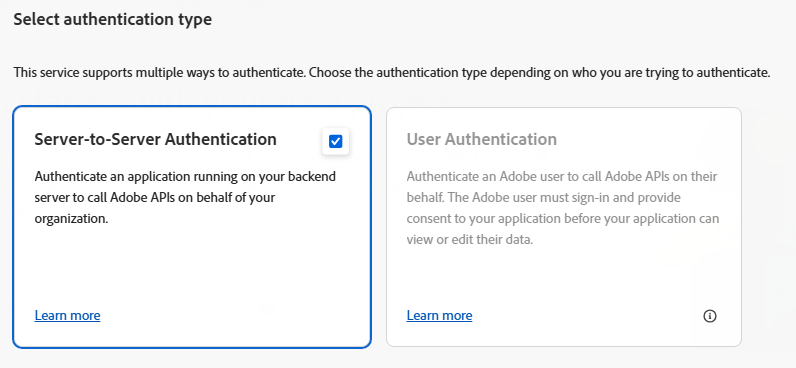
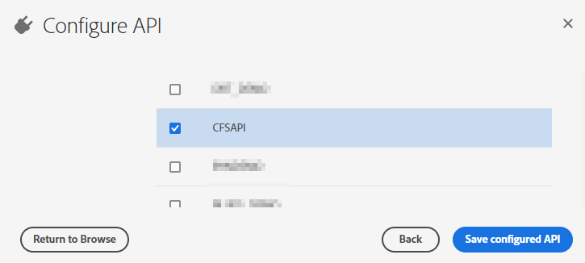
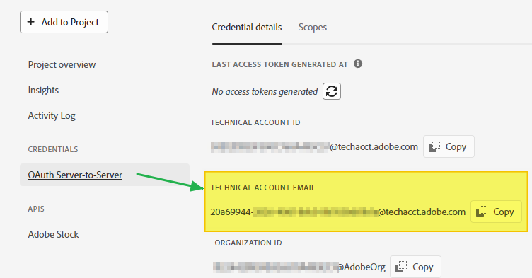
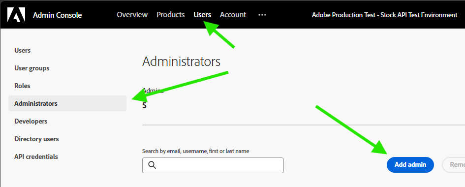
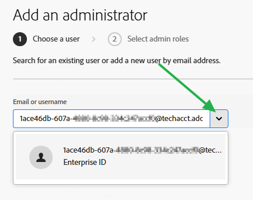
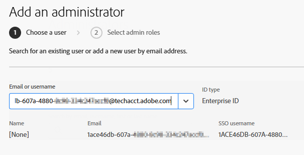
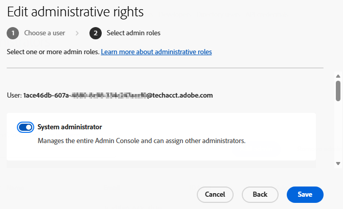

# Creating an API integration for the License History Report CSV API

\<!-- MarkdownTOC --\>

* [Overview](#overview)
    * [Assumptions](#assumptions)
* [Developer Console steps](#developer-console-steps)
* [Admin Console steps](#admin-console-steps)
* [Resources](#resources)

\<!-- /MarkdownTOC --\>

## Overview

To use the License History Report CSV API, Adobe Stock enterprise customers must first create a Server-to-Server integration in the Developer Console and then promote the API integration to be an administrator for the organization. This document covers both processes.

### Assumptions

- The organization must have an enterprise Stock organization. Stock for Teams/VIP consoles will not have the correct privileges, and Creative Cloud Enterprise (CCE) customers will also not have permission unless they also have a dedicated enterprise Stock contract.

- To create an integration, the user will need to access both the Admin Console and the Developer Console. Only System Admins or members of the Developers group can create integrations in the Dev Console.

  - For more info on assigning Developer rights, see [https://helpx.adobe.com/business/enterprise/manage-users/manage-developers.html](https://helpx.adobe.com/business/enterprise/manage-users/manage-developers.html).

## Developer Console steps

- Sign into [https://developer.adobe.com/console/home](https://developer.adobe.com/console/home)

- Create a new project.

- Add an API to the project and choose **Adobe Stock**.

- Choose **Server-to-Server Authentication**.

  - Note that if the only option you see is for User Authentication, then you do not have the correct permission, or you have selected the wrong organization. That integration type will not work for this API.

> 

- Choose a Stock profile from the list of options. Only select ONE profile.

  - Best practice is to first create a new Stock product profile to be used with the API using the Admin Console. Every organization should have a “Default Adobe Stock” profile that can be used as a fallback. *The choice of profiles will not influence the use of the API*.

    - To learn more about product profiles, see [Create/edit a product profile for Adobe Stock](https://helpx.adobe.com/enterprise/using/adobe-stock-enterprise.html#CreateeditaproductprofileforAdobeStock).

> 

- After the Stock integration is created, click the **OAuth Server-to-Server** link on the side, scroll down the page and copy the **Technical Account EMAIL**. You will need this for the Admin Console. *Do not copy the Technical Account ID*, as that will not work here.

> 

## Admin Console steps

The process above will create a special user account inside the organization, but it is hidden from view. In these next steps, you will find the hidden user and promote it to admin.

- Open the Admin Console [https://adminconsole.adobe.com/enterprise](https://adminconsole.adobe.com/enterprise).

- Go to **Users**, select **Administrators** from the left-hand rail, and click **Add admin**.

> 

- In the new dialog box, paste the Technical Account Email address and click the **down arrow**. It should populate with an Enterprise ID. Then click **Next**.

 

- Give the account **System Administrator** rights. This will ensure the API integration can view all assets in the organization.

> 

The integration should now be ready to test.

## Resources

Server to Server authentication guide:\
[https://developer.adobe.com/developer-console/docs/guides/authentication/ServerToServerAuthentication/](https://developer.adobe.com/developer-console/docs/guides/authentication/ServerToServerAuthentication/)

Assigning Developers for an organization (Admin Console):\
[https://helpx.adobe.com/business/enterprise/manage-users/manage-developers.html](https://helpx.adobe.com/business/enterprise/manage-users/manage-developers.html)

Creating product profiles (Admin Console):\
[https://helpx.adobe.com/enterprise/using/adobe-stock-enterprise.html#CreateeditaproductprofileforAdobeStock](https://helpx.adobe.com/enterprise/using/adobe-stock-enterprise.html#CreateeditaproductprofileforAdobeStock)

Adobe Stock API documentation (note that the new API is not currently documented here)\
[https://developer.adobe.com/stock/docs/getting-started/](https://developer.adobe.com/stock/docs/getting-started/)
